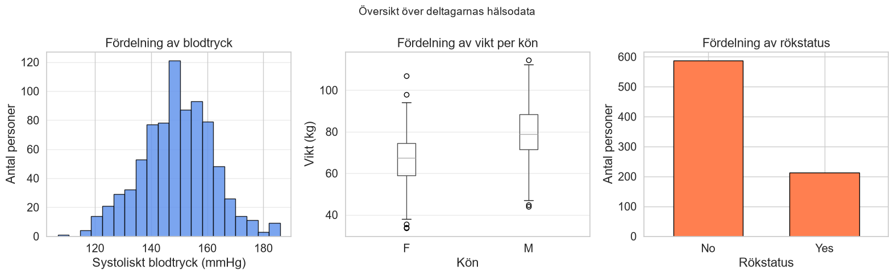
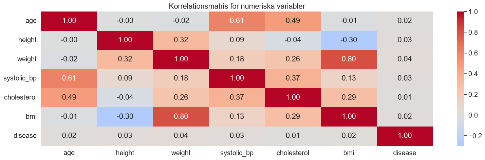
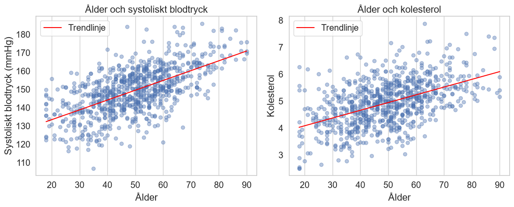
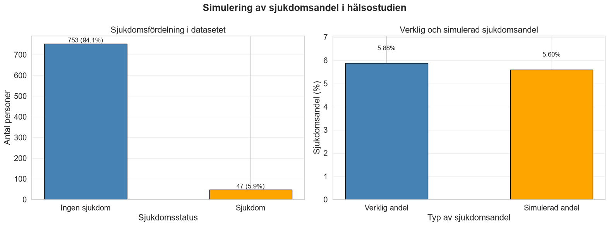
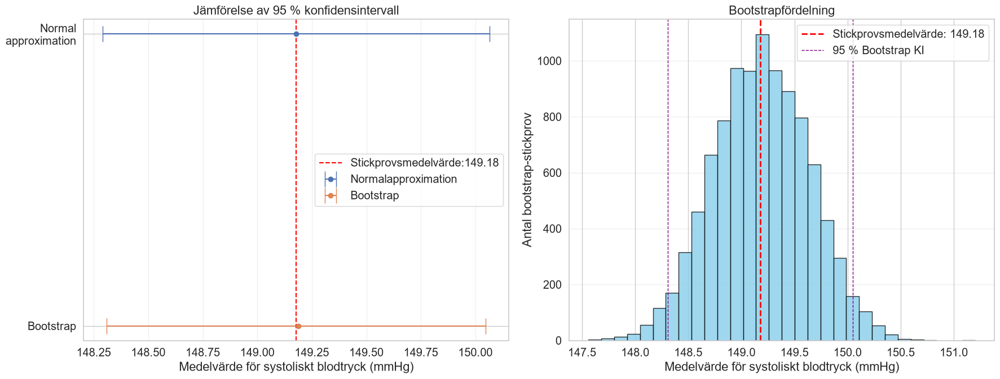
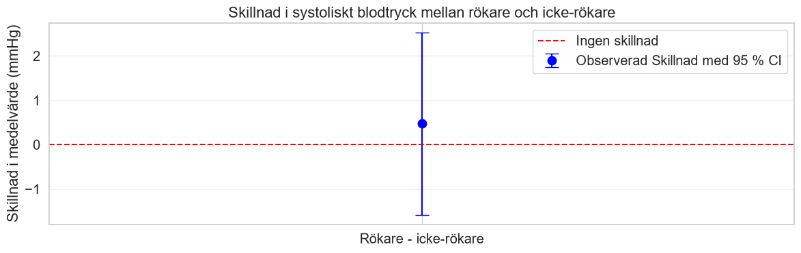
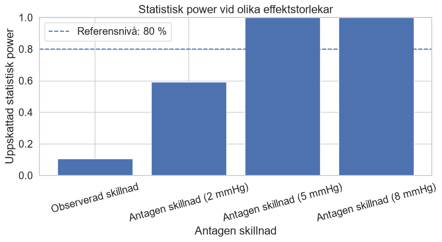
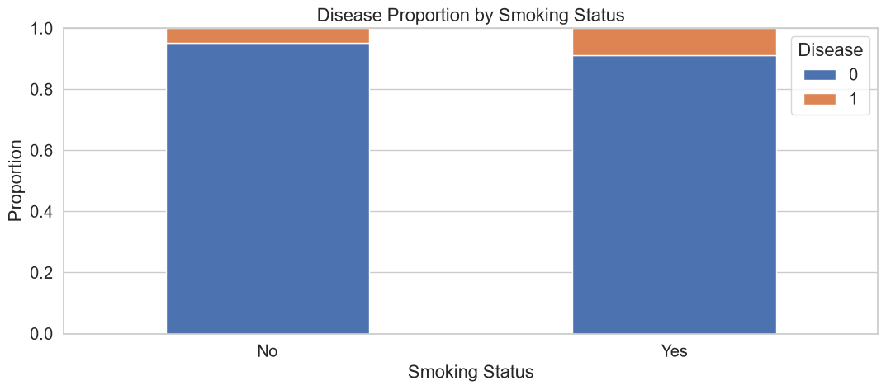
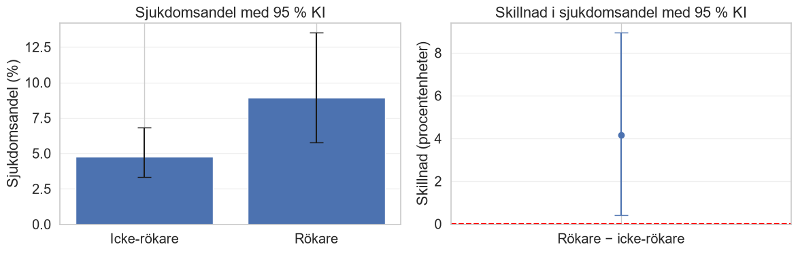
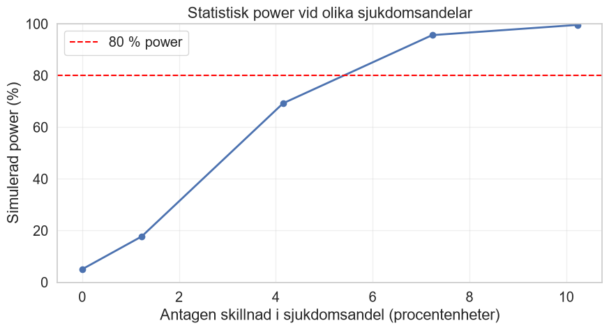

# Hälsostudie

## Syfte 
Undersöka hälsodata med beskrivande statistik, visualiseringar, simulering, konfidensintervall och hypotesprövning. Huvudfrågan i den analysen är **om rökare har högre genomsnittligt systoliskt blodtryck än icke-rökare**. Den efterföljande separata analysen av sjukdomsandelar.

## Datamaterial och kvalitet
- **800 deltagare**, 9 ursprungliga kolumner.
- **0 saknade värden** och **0 duplicerade hela rader** i notebookens kontroller.
- Medelålder **49,43 år** (18–90), medelvikt **73,41 kg**, medellängd **171,85 cm**.
- Systoliskt blodtryck: medelvärde **149,18 mmHg**, median **149,40 mmHg**, standardavvikelse **12,79 mmHg**.
- Kolesterol: medelvärde **4,93** och standardavvikelse **0,85**.

## 1. Explorativ analys



Figurerna ger en översikt över fördelningar och möjliga avvikare. Blodtrycket sträcker sig från **106,8 till 185,9 mmHg**. Medelvärde och median för blodtryck ligger nära varandra.



Korrelationsfiguren visar möjliga samband mellan numeriska variabler. 
Ålder har ett positivt samband med systoliskt blodtryck
(r = 0,61) och kolesterol (r = 0,49).

Vikt och BMI har ett starkt positivt samband (r = 0,80).
Sjukdomsstatus har mycket svaga korrelationer med de
numeriska variablerna.



Blodtryck och kolesterol tenderar att öka med åldern.
Sambanden visar en positiv trend, men innebär inte
nödvändigtvis orsakssamband.

## 2. Simulering av sjukdomsförekomst



Observerad sjukdomsandel är **5,88 % (47 av 800)** och simulerad andel bland **1 000 personer är 5,60 %**. Skillnaden är cirka **0,28 procentenheter** och illustrerar slumpvariation.

## 3. Konfidensintervall för systoliskt blodtryck



| Metod | 95 % konfidensintervall |
|---|---|
| Normalapproximation | **148,29–150,07 mmHg** |
| Bootstrap | **148,31–150,05 mmHg** |

Medelvärdet är **149,18 mmHg** (n = 800). Bootstrapmedelvärdet är **149,19 mmHg** och båda standardfelen är cirka **0,45 mmHg**. Metoderna ger samstämmiga skattningar.

## 4. Hypotesprövning – rökare och blodtryck

**H₀:** Rökare har inte högre genomsnittligt systoliskt blodtryck än icke-rökare.  
**H₁:** Rökare har högre genomsnittligt systoliskt blodtryck än icke-rökare.



| Mått | Resultat |
|---|---:|
| Rökare | **n = 213; 149,52 mmHg** |
| Icke-rökare | **n = 587; 149,05 mmHg** |
| Observerad skillnad | **+0,47 mmHg** |
| Ensidigt Welch t-test | **t = 0,4503; p = 0,3264** |
| Tvåsidigt 95 % KI för skillnaden | **−1,59 till +2,53 mmHg** |
| Cohen’s d | **0,037** |

**Tolkning:** Vid α = 0,05 förkastas inte nollhypotesen. Skillnaden är liten och konfidensintervallet omfattar noll. Det finns inte tillräckligt statistiskt stöd för högre medelblodtryck bland rökare i detta urval. Ett icke-signifikant resultat bevisar inte att ingen skillnad finns.

## 5. Simulerad power



| Antagen skillnad | Simulerad power |
|---|---:|
| 0,47 mmHg (observerad) | **10,6 %** |
| 2 mmHg | **59,2 %** |
| 5 mmHg | **99,9 %** |
| 8 mmHg | **100,0 %** |

**Tolkning:** Större antagna skillnader upptäcks oftare med samma stickprovsstorlekar.

## Slutsats

Analysen visar ett genomsnittligt systoliskt blodtryck på **149,18 mmHg**. Rökare hade **0,47 mmHg** högre medelvärde än icke-rökare, men Welch-testet gav **p = 0,3264** och det tvåsidiga 95 %-konfidensintervallet för skillnaden var **−1,59 till +2,53 mmHg**. Resultatet ger **inte tillräckligt statistiskt stöd** för att rökare har högre medelblodtryck i detta urval. Normalapproximation och bootstrap gav mycket lika konfidensintervall för det övergripande medelblodtrycket.


# Analys av sjukdomsandel mellan rökare och icke-rökare

## 1. Introduktion

Syftet med analysen är att undersöka om sjukdomsandelen
skiljer sig mellan rökare och icke-rökare.

Datasetet innehåller 800 deltagare och två kategoriska
variabler som används i jämförelsen:

- `smoker`: Yes (rökare) eller No (icke-rökare)
- `disease`: 1 (sjukdom) eller 0 (ingen sjukdom)

## 2. Beskrivande statistik – Sjukdomsandel

| Grupp | Antal | Sjukdomsfall | Andel |
|---|---:|---:|---:|
| Icke-rökare (A) | 587 | 28 | 4,8 % |
| Rökare (B) | 213 | 19 | 8,9 % |



**Tolkning:**

Andelen personer med sjukdom är högre bland rökare
(8,9 %) än bland icke-rökare (4,8 %).

Den observerade skillnaden är 4,15 procentenheter.

## 3. Konfidensintervall och hypotesprövning

###  Konfidensintervall

95 % konfidensintervall beräknas med Wilsons metod
för respektive grupp och Newcombes metod för skillnaden.

| Mått | Resultat |
|---|---:|
| Icke-rökare, 95 % KI | 3,3–6,8 % |
| Rökare, 95 % KI | 5,8–13,5 % |
| Absolut skillnad | 4,15 procentenheter |
| Relativ skillnad | 87,0 % |
| Skillnadens 95 % KI | 0,41–8,96 procentenheter |



**Tolkning:**

Konfidensintervallet för skillnaden ligger över noll,
vilket ger stöd för en högre sjukdomsandel bland rökare.

Intervallets bredd visar att det finns osäkerhet
kring den verkliga skillnadens storlek.

###  Hypotesprövning

Ett z-test för två oberoende proportioner används.

**Tvåsidigt test:**
- H₀: Sjukdomsandelen är lika i båda grupperna.
- H₁: Sjukdomsandelen skiljer sig mellan grupperna.

**Ensidigt test:**
- H₀: Sjukdomsandelen är inte högre bland rökare.
- H₁: Sjukdomsandelen är högre bland rökare.

Signifikansnivå: α = 0,05.

| Testresultat | Värde |
|---|---:|
| Z-statistik | 2,2063 |
| Tvåsidigt p-värde | 0,0274 |
| Ensidigt p-värde | 0,0137 |

**Tolkning:**

Båda p-värdena är lägre än 0,05.
Nollhypotesen förkastas vid 5 % signifikansnivå.

Resultatet visar en statistiskt signifikant högre
sjukdomsandel bland rökare än bland icke-rökare.

## 4. Analytisk poweranalys

Statistisk power beräknas med `NormalIndPower`
och effektstorleken Cohen's h.

Syftet är att undersöka sannolikheten att upptäcka
en verklig skillnad av den antagna storleken.

| Mått | Resultat |
|---|---:|
| Cohen's h | 0,166 |
| Analytisk power | 66,8 % |
| Målnivå | 80 % |

**Tolkning:**

Den analytiska powern är 66,8 % för den observerade
skillnaden använd som antagen effektstorlek.

Detta ligger under målnivån på 80 % och visar att
studien har begränsad förmåga att upptäcka
en skillnad av denna storlek.

## 5. Simulerad statistisk power

Power uppskattas genom 5 000 simuleringar med
binomialfördelning och ett ensidigt z-test.

| Metod | Power |
|---|---:|
| Analytisk power | 66,8 % |
| Simulerad power | 69,3 % |
| Skillnad | 2,58 procentenheter |

**Tolkning:**

Analytisk och simulerad power ger relativt liknande
resultat. Båda ligger under målnivån på 80 %.

## 6. Power vid olika antagna sjukdomsandelar

Sjukdomsandelen bland icke-rökare hålls konstant
vid cirka 4,8 %, medan den antagna andelen
bland rökare varierar.

| Andel bland rökare | Skillnad | Power |
|---|---:|---:|
| 4,8 % | 0,00 pp | 4,9 % |
| 6,0 % | 1,23 pp | 17,6 % |
| 8,9 % | 4,15 pp | 69,0 % |
| 12,0 % | 7,23 pp | 95,6 % |
| 15,0 % | 10,23 pp | 99,8 % |

*pp = procentenheter.*



**Tolkning:**

Power ökar när den antagna skillnaden i sjukdomsandel
blir större.

Studien har låg power vid små skillnader, men hög
power vid större skillnader.


## Sammanfattning

Analysen visar att sjukdomsandelen är högre bland
rökare (8,9 %) än bland icke-rökare (4,8 %).

Den observerade skillnaden är 4,15 procentenheter,
och det tvåsidiga z-testet visar ett statistiskt
signifikant resultat (p = 0,0274).

Poweranalysen visar däremot att studien har
begränsad förmåga att upptäcka mindre skillnader.


## Teknik och bibliotek

- Python - 3.14.7
- Pandas och NumPy
- Matplotlib
- SciPy
- Statsmodels
- Jupyter Notebook

## Kör projektet

### 1. Klona projektet

Öppna terminalen i VS Code och klona projektet:

```bash
git clone https://github.com/SelviKumarasamy/Health_Study.git
cd Health_Study
```

### 2. Skapa en virtuell miljö

```bash
python -m venv .venv
```

Aktivera miljön i Git Bash på Windows:

```bash
source .venv/Scripts/activate
```

### 3. Installera bibliotek

Installera projektets beroenden:

```bash
pip install -r requirements.txt
```

### 4. Kör analysen

Kör cellerna i ordning med **Restart & Run All**.
